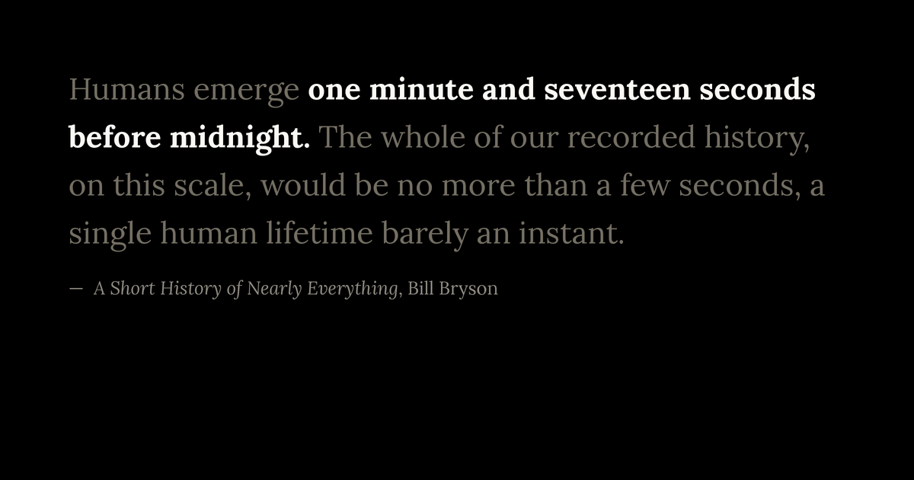

# MMM-LiteraryClock


A **literary clock** for [MagicMirror²](https://magicmirror.builders/). Every
minute it shows a passage from a book that mentions the current time, with the
time phrase emphasised — so you read the time straight off the page.



At 12:00 you might get *Romeo and Juliet* ("the dial is now upon the prick of
**noon**"); at 09:00, *Death in Venice*; at 23:58, Bill Bryson. The bundled
catalogues contain passages for **1438 of the 1440 minutes** in a day.

It ships with its own serif (**Lora**, bundled locally — no Google Fonts call at
runtime) and page-like styling, and overrides MagicMirror's default font so it
actually reads like a book. There are **no external dependencies**.

## Status and compatibility

**Status:** released and actively maintained.

MMM-LiteraryClock requires MagicMirror² 2.25.0 or newer. The current automated
validation target is MagicMirror² 2.37.0 with Node.js 22.21.1. It has no
external service requirement and is intended for ordinary MagicMirror
installations as well as appliance-style layouts.

## Install

```bash
cd ~/MagicMirror/modules
git clone https://github.com/bwente/MMM-LiteraryClock.git
```

No `npm install` step is required.

## Configuration

Add the module to `config/config.js`:

```js
{
  module: "MMM-LiteraryClock",
  position: "middle_center",
  config: {
    fontSize: 28,
    quoteColor: "#736e62",
    timeColor: "#fbf9f4"
  }
},
```

Restart the mirror (e.g. `pm2 restart MagicMirror`).

## Update

Pull the latest version from the module directory, then restart MagicMirror:

```bash
cd ~/MagicMirror/modules/MMM-LiteraryClock
git pull
pm2 restart MagicMirror
```

## Configuration options

All options are optional; defaults are shown.

| Option | Default | Description |
|--------|---------|-------------|
| `fontSize` | `28` | Quote body size in px. `maxWidth` scales with it. |
| `maxWidth` | `"34em"` | Text measure. Narrower breaks more like a printed page. |
| `quoteColor` | `"#736e62"` | Body text colour. Kept dim on purpose — the gap to `timeColor` is what makes the time readable at a glance. |
| `timeColor` | `"#fbf9f4"` | Colour of the emphasised time phrase (also used for the digital fallback). |
| `attributionColor` | `"#8f8b82"` | Colour of the "— Title, Author" line. |
| `showAttribution` | `true` | Show the title/author line. |
| `updateOnMinute` | `true` | Refresh exactly on the minute boundary. |
| `refreshMinutes` | `1` | Only used when `updateOnMinute` is `false`: refresh every N minutes (useful for e-ink). |
| `fadeSpeed` | `1500` | Crossfade duration in ms when the quote changes. |
| `allowNSFW` | `false` | Include quotes flagged `nsfw` in the source data. |
| `allowUnknown` | `true` | Include quotes with an `unknown` rating. Most of the corpus is unrated, so turning this off gives sfw-only but drops coverage sharply. |
| `locale` | `""` | Optional quote-catalogue override. Blank follows MagicMirror's global `locale` or `language`. Available catalogues: `"de-DE"`, `"en-GB"`, `"en-US"`, `"es-ES"`, `"fr-FR"`, `"it-IT"`, and `"pt-PT"`. |
| `dataFile` | `""` | Path to an alternative dataset (see below). When set, this overrides `locale`. |

## Deeper styling

The configuration options above cover most needs. For anything more, every rule is
scoped to `.MMM-LiteraryClock`, so you can override it from your mirror's
`css/custom.css` without touching this module:

```css
.MMM-LiteraryClock .litclock-quote { line-height: 1.7; }
.MMM-LiteraryClock .litclock-time  { text-shadow: 0 0 2px rgba(255,255,255,.5); }
```

To swap the typeface, drop new `woff2` files into `fonts/` and update the
`@font-face` `src` URLs at the top of `MMM-LiteraryClock.css`.

## Languages and custom datasets

The module bundles German, American English, British English, Spanish, French,
Italian, and Portuguese literary catalogues. By default it follows
MagicMirror's global `locale` setting, then its `language` setting. For example,
this main MagicMirror configuration automatically selects the German catalogue:

```js
language: "de",
locale: "de-DE",
```

To use a different catalogue only for this module, set its `locale` override:

```js
config: { locale: "de-DE" }
```

The short forms `de`, `en`, `es`, `fr`, `it`, and `pt` are also accepted.
`en-UK` is treated as `en-GB`, and underscores such as `de_DE` may be used in
place of hyphens. An unavailable locale falls back to `en-US`. All catalogues
are bundled with the module and require no network connection. Only the
selected catalogue is loaded into memory.

The separate American and British English catalogues preserve regional
spelling and numeric-time conventions. For example, the default `en-US`
catalogue uses `7:59` where the `en-GB` catalogue uses `7.59`.

For another language or a custom catalogue, point `dataFile` at a local
pipe-delimited dataset. The maintained upstream format is:

```
Time|Id|Quote time|Quote|Title|Author|SFW
23:58|2358-000|before midnight|Humans emerge one minute...|A Short History...|Bill Bryson|sfw
```

The original six-column format without a header or ID remains supported.
`Time` is `HH:MM` (24-hour), `Quote time` must be the exact substring to
emphasise, and `SFW` is `sfw`, `nsfw`, or `unknown`. Relative paths resolve
against the module folder:

```js
config: { dataFile: "datasets/litclock_de.csv" }
```

The [cdmoro/literature-clock](https://github.com/cdmoro/literature-clock)
project maintains additional language catalogues. Downloaded custom catalogues
remain local; the module never fetches them at runtime.

## Coverage & fallback

1438 of 1440 minutes have at least one quote. The currently uncovered minutes
are 10:28 and 18:44. For an uncovered minute, or when
the selected safety filters leave no matching quote for that minute, the module
shows a plain digital `HH:MM` rather than displaying a quote for the wrong time.

## Testing

```bash
npm test
```

Runs a small suite (Node's built-in test runner, no dependencies) covering
dataset parsing, full-day coverage, and time-phrase highlighting.

## Credits & licence

- **Module code** — MIT (see [LICENSE](LICENSE)). Third-party licensing and
  attribution details are recorded in [THIRD_PARTY_NOTICES.md](THIRD_PARTY_NOTICES.md).
- **Quote data** (`datasets/quotes.*.csv`) —
  maintained by the [cdmoro/literature-clock](https://github.com/cdmoro/literature-clock)
  project and pinned to the revision recorded in [datasets/SOURCE.md](datasets/SOURCE.md),
  originally **crowd-sourced by The Guardian** and inspired by **Jaap Meijers'**
  [e-reader clock](https://www.instructables.com/id/Literary-Clock-Made-From-E-reader/).
  The quotations are short excerpts from their respective copyrighted works,
  included for the literary-clock purpose; they remain the property of their
  rights holders and are **not** covered by this module's MIT licence.
- **Font** — [Lora](https://fonts.google.com/specimen/Lora) by Cyreal, under the
  SIL Open Font License v1.1 (bundled as [fonts/OFL.txt](fonts/OFL.txt)).

Not affiliated with, or endorsed by, The Guardian. If you are a rights holder
and would like a quotation removed, please open an issue.
